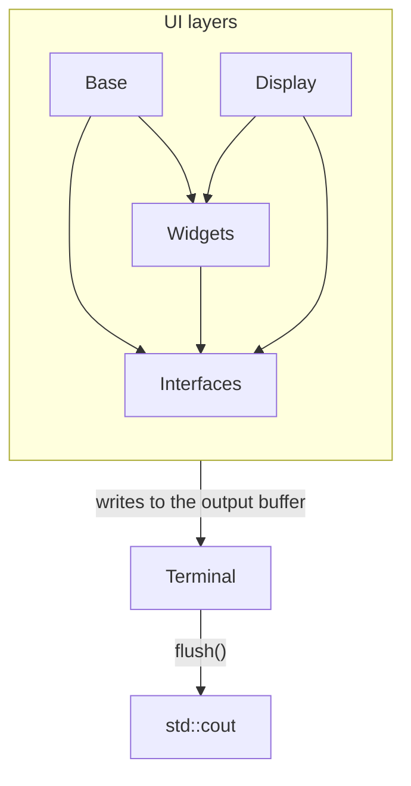

# termui — Class Relations

This file shows the structural layout of the termui library and how data is passed between the layers of abstraction.

## Layer Descriptions

### Base Layer
The fundamental building block of the termui library. Base classes provide core functionality and can be extended to create widgets.

### Widget Layer
Widgets are constructed from Base and Display classes and provide interactive TUI elements such as lists, tables and buttons. They hold the state for an element, but the caller decides when to change it.

### Interface Layer
Interfaces are full-screen modal screens built from Base, Display and Widget classes. Each one sets up the terminal, runs its own input loop, and returns control to the application when it closes.

### Display Layer
Differentiated from Base, the Display layer conveys information graphically rather than through plain text. It contains more decorative TUI elements and visual enhancements.

## Terminal Design

The `Terminal` is intentionally designed to separate concerns:

- **Terminal**: Aware of its capabilities regarding color and styling support, and responsible for converting `Style` information into the ANSI escape codes the terminal understands.
- **Decoupled Design**: Higher-level classes (`Base`, `Widget`, `Interface`) should not contain logic to deal with color and styling details.

This separation of concerns allows all classes to pass text and styling information to the `Terminal`, offloading the complexity of terminal capabilities and ANSI code generation from the UI layer.

Every layer writes into the `Terminal`'s output buffer, which reaches `std::cout` when `flush()` is called.
